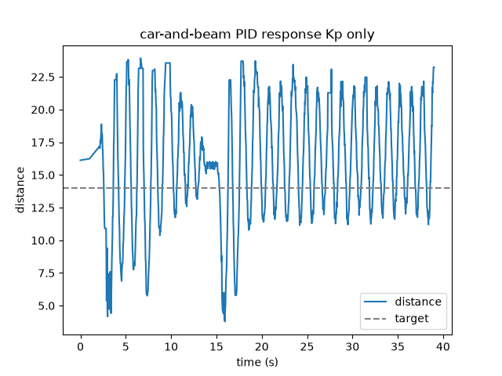
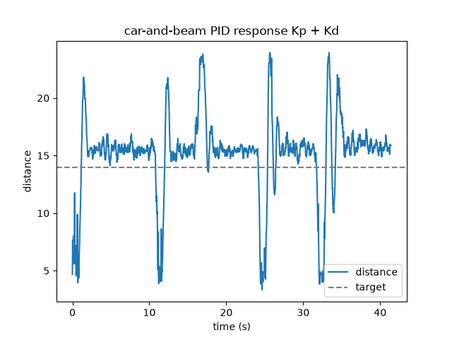
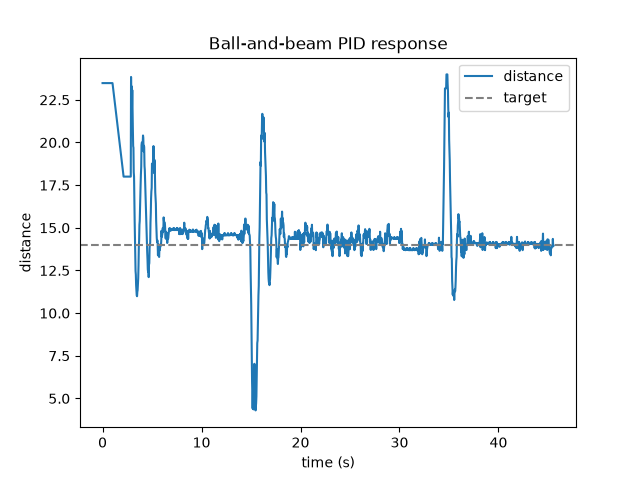

# Ball-and-Beam PID Controller

Oct 4, 2026 · @Jordaine Wisdom

## What it is

A ball-and-beam balancing rig that keeps a Hot Wheels car parked at a set point on a tilting beam, controlled by a PID loop running on an Arduino. An ultrasonic sensor at one end measures how far the car is; a servo at the other end tilts the beam to roll the car back toward the target. It's a from-scratch PID project built to re-learn closed-loop control by hand, sensor, controller, actuator, all tuned on the bench.

There's a video explainer that walks through the control theory using this exact rig: [PID explainer video](https://www.instagram.com/p/DePeRX4AhHJ/).

## How it works

Every loop, the controller does four things:

1. **Sense.** The ultrasonic sensor reads the car's distance from the end of the beam.
2. **Compare.** Error is the gap between that distance and the target position.
3. **Compute.** The three PID terms each weigh in on the correction.
4. **Act.** The sum becomes a servo angle, the beam tilts, and the car rolls back toward target.

What each term contributes:

- **P (proportional)** pushes in proportion to how far off the car is, bigger error, bigger tilt. On its own it overshoots and oscillates, because it knows position but not speed.

- **D (derivative)** reacts to how fast the error is changing and fights the motion, the brake that damps the oscillation so the car eases onto target instead of sailing past.

- **I (integral)** sums the error over time, so a small persistent offset keeps building until the controller nudges the car the last bit onto the line. This is what kills steady-state error.

## Key engineering takeaways

The things that actually made it work, most of which only became obvious from building it:

- **Constrain the servo range, don't use its full travel.** The biggest unlock. I assumed I needed the servo to swing all the way one way and all the way the other. It turned out that had nothing to do with it. By clamping the beam tilt to a narrow band, I limited how steep the beam could get, which capped how hard gravity pulled the car, which capped its acceleration. A car that can't rocket off gives the loop time to sense, compute, and correct before it's too late. I traded away range I didn't need for controllability I did. (This is essentially control authority and actuator limits, arrived at from the bench.)
- **The sign of the correction matters, and you can't guess it from your chair.** With the output sign wrong, the car bolts to one end instead of correcting. Flipping it from adding to subtracting the output fixed the runaway.
- **Guard the sensor against garbage reads.** The ultrasonic reports a junk value when the car is too close or it gets no echo. A last-good guard, only accept a reading inside the valid range, keeps a bad value from spiking the D term.
- **Some problems are mechanical, not tuning.** The car was rolling off the open end before the loop could recover. Adding an end wall defined the workspace and gave many clean oscillations per run, a standard move on these rigs.
- **Anti-windup.** Only accumulate the integral when the servo isn't maxed out, so the I term doesn't wind up a correction it can't deliver.

## Tuning

The process, in order:

1. **Raise P until it oscillates.** Pushed the proportional gain up while watching for steady oscillation, hunting the edge of stability.
2. **Add D to damp it.** Derivative pulled the overshoot out and brought the car in cleanly. Worth knowing: overshoot comes down by raising D, not P.
3. **Watch steady-state error appear.** With P and D only, the car settled consistently, but above the target line, not on it. A visible, persistent gap.
4. **Add I to close the gap.** The integral term built up against that offset and pulled the car right onto the target line.

Residual jitter at the end is real system noise, mostly the ultrasonic's noise floor feeding the D term. A good part-two rabbit hole is sensor filtering, but it wasn't worth delaying the result.

Servo reference points measured on the rig: flat/center at one angle, with left and right limits pulled in from the mechanical extremes to spare the servo. The exact numbers live in the sketch.

## Repo contents

| File | What it does |
| --- | --- |
`PID.ino` The main Arduino PID sketch, reads the ultrasonic sensor, computes P/I/D, writes the servo angle, with the last-good guard and anti-windup |

`serial_plot.py` A pyserial + matplotlib script that captures the labeled serial stream and plots distance vs target with real seconds on the x-axis |

`plots/` The captured runs: steady-state error (P and D only) and the clean settle after adding I |
